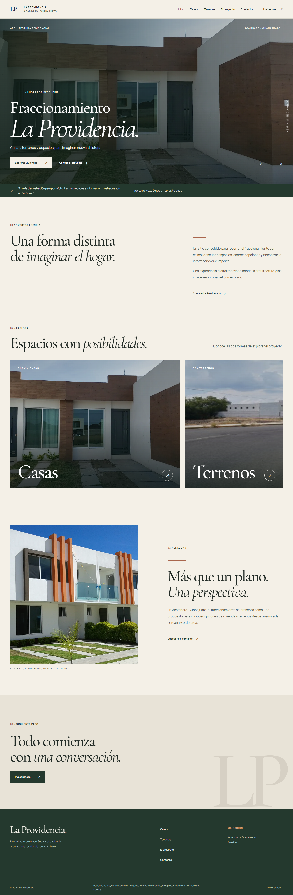
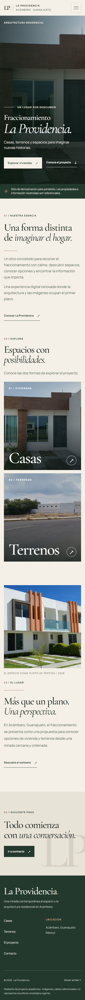
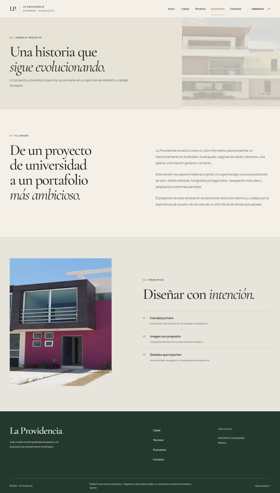

# Fraccionamiento La Providencia

Rediseño editorial contemporáneo del proyecto académico **Fraccionamiento La Providencia**, ubicado en Acámbaro, Guanajuato.

> Este sitio es una demostración de portafolio. Las propiedades, fotografías y descripciones son referenciales; no representan una oferta inmobiliaria vigente.

## Tecnologías

- HTML5 semántico y navegación accesible.
- CSS3 responsive con variables de diseño, Grid, Flexbox y media queries.
- JavaScript vanilla para menú móvil, estados de navegación y validación demostrativa del formulario.
- Tipografías Cormorant Garamond y Manrope mediante Google Fonts.
- Fotografías originales con `<picture>`, formato WebP y fallback a los archivos originales.
- Verificación visual en escritorio de 1440 px y móvil de 390 px.

## Páginas

- `index.html` — Inicio y presentación del proyecto.
- `casas.html` — Catálogo visual de modelos de vivienda.
- `terrenos.html` — Catálogo visual de terrenos y entorno.
- `about.html` — Historia, contexto y principios del proyecto.
- `contactanos.html` — Formulario demostrativo y ubicación.

## Mejoras realizadas

- Nueva dirección de arte editorial: marfil, verde profundo, terracota y fotografía auténtica.
- Jerarquía tipográfica refinada con mejor legibilidad, contraste y ancho de lectura.
- Áreas táctiles de al menos 44 px para navegación y acciones principales.
- Menú móvil con estado accesible, cierre con `Escape` y bloqueo de scroll.
- Imágenes optimizadas con WebP, `loading="lazy"` y `decoding="async"` donde corresponde.
- Layout responsive validado sin overflow horizontal.
- Estados de foco visibles y textos alternativos para las fotografías.
- Avisos claros para evitar confundir el catálogo con inventario o ventas actuales.

## Formulario de contacto

El formulario es exclusivamente demostrativo: valida los campos en el navegador, muestra un mensaje local y no envía ni almacena datos. Para convertirlo en contacto real sería necesario conectar un servicio propio.

## Capturas

### Inicio — escritorio

### Inicio — móvil

### El proyecto — escritorio

## Validación

La última revisión cubrió las cinco rutas en escritorio y móvil:

- 10 combinaciones de página y viewport con respuesta HTTP 200.
- Sin errores de consola ni fallos de red.
- Sin desbordamiento horizontal.
- Sin targets táctiles visibles por debajo de 44 px.
- Menú móvil y formulario demostrativo verificados.
